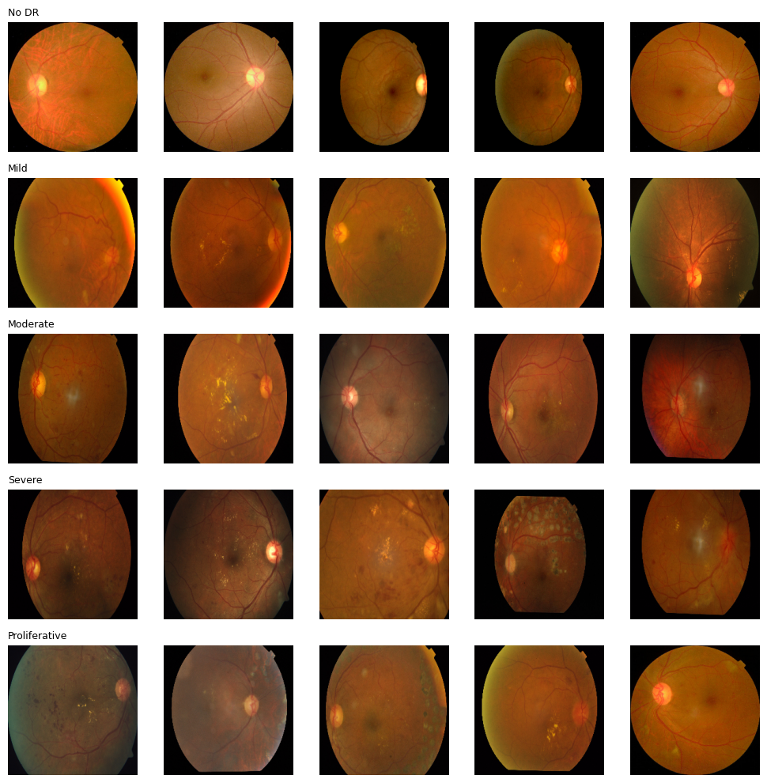
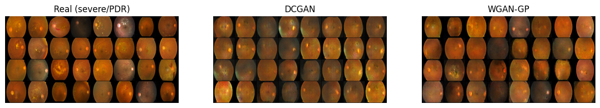
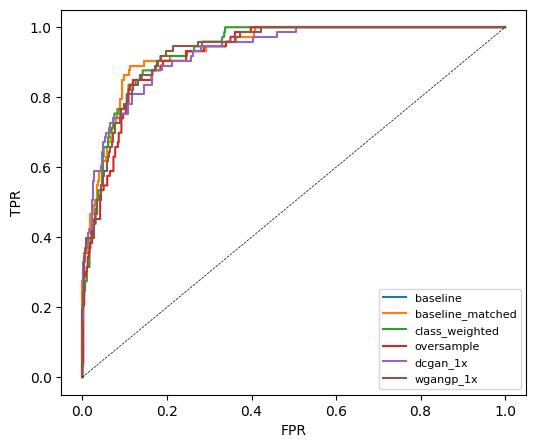
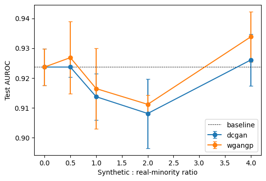
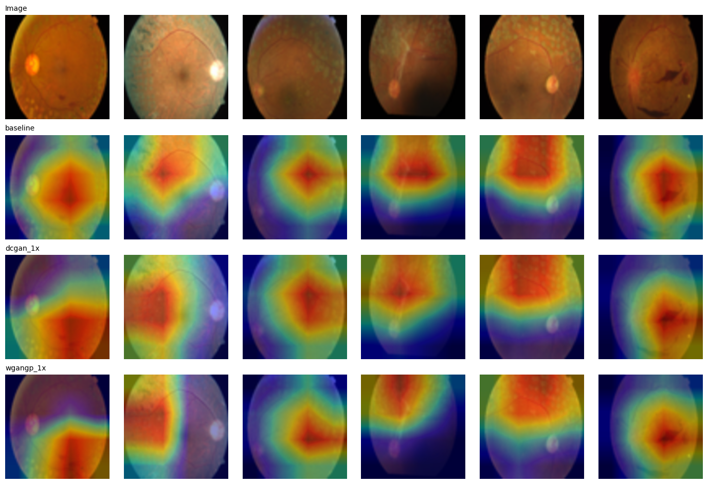

# Does GAN-Based Data Augmentation Help Diabetic Retinopathy Classification? A Controlled Study of Synthetic Ratio, Generator Type and Backbone

> **TL;DR.** On APTOS 2019 fundus images, I trained DCGAN and WGAN-GP to synthesize severe/proliferative DR images (the 13.3% minority class) and tested whether adding them improves a classifier. I varied the **generator** (DCGAN vs WGAN-GP), the **amount of synthetic data** (0.5×, 1×, 2×, 4× the real minority count), and the **backbone** (ResNet-18, EfficientNet-B0), with 3 seeds each, a matched-compute baseline and paired bootstrap CIs. **No GAN configuration produced a statistically significant improvement over the no-augmentation baseline.** The effect of synthetic ratio is non-monotonic and within seed noise, the ranking of classical remedies depends on the backbone, and GAN-augmented models attend less to the retina.

**Keywords:** medical imaging, diabetic retinopathy, class imbalance, GAN, DCGAN, WGAN-GP, synthetic data, dose-response, Grad-CAM, KID, reproducibility

---

## 1. Motivation

Severe and proliferative diabetic retinopathy (PDR) are the most sight-threatening grades, yet they are the rarest in screening datasets. GAN-based oversampling is a popular proposed remedy for this imbalance in medical imaging, but many reports compare against weak baselines (no class weighting, no compute matching, single seed, single synthetic ratio, one backbone, no confidence intervals). This project asks a narrow, falsifiable question:

> **Does adding GAN-synthesized minority-class images improve detection of severe/PDR over standard imbalance remedies, once the comparison is properly controlled, and does the answer depend on how much synthetic data is used or on the classifier?**

## 2. Dataset

- **APTOS 2019 Blindness Detection**, 224×224 version (`sovitrath/diabetic-retinopathy-224x224-2019-data` on Kaggle), 3,662 images, 5 grades.
- **Task:** binary, *severe + proliferative (grades 3–4)* vs *all others*.

| Grade | No DR | Mild | Moderate | Severe | Proliferative |
|---|---|---|---|---|---|
| Images | 1805 | 370 | 999 | 193 | 295 |

Minority (grade 3–4): **488 images (13.3%)**.

**Split** (stratified by grade, `random_state=42`): train 2,563 (342 positive) / val 549 (73) / test 550 (73). GANs are trained **only on the 342 training positives**; val and test are never seen by any generator.



## 3. Methods

| Component | Details |
|---|---|
| Image resolution | 64×64 for GAN training; upsampled to 128×128 for the classifier |
| **DCGAN** | Transposed-conv generator, spectral-norm discriminator, label smoothing (0.9), flip augmentation on real+fake, 600 epochs, Adam (2e-4, β=(0.5, 0.999)) |
| **WGAN-GP** | Same generator, GroupNorm critic, λ=10, n_critic=5, 4,000 generator steps, Adam (1e-4, β=(0, 0.9)) |
| GAN seeds | 3 per architecture (0, 1, 2) |
| **Classifiers** | ImageNet-pretrained **ResNet-18** (main) and **EfficientNet-B0** (robustness check), 12 epochs, AdamW (lr 1e-4, wd 1e-4), AMP, flips/rot90/brightness augmentation |
| Model selection | Best validation AUROC epoch |
| Classifier seeds | 3 per method |
| Operating point | Threshold set at **90% specificity on the validation set**; sensitivity reported on test |

**Compared strategies**

1. `baseline`: no imbalance handling
2. `baseline_matched`: baseline trained for the same number of gradient steps as the 1× GAN-augmented runs (controls for "more training")
3. `class_weighted`: positive-class weighted BCE
4. `oversample`: balanced re-sampling of real minority images
5. `dcgan_Rx` / `wgangp_Rx`: + R × 342 synthetic positives, with **R ∈ {0.5, 1, 2, 4}**

**Evaluation:** test AUROC, average precision (AP), sensitivity at 90% specificity, paired bootstrap (1,000 resamples) for AUROC differences, KID and nearest-neighbour distance for generator quality, Grad-CAM for attention analysis.

## 4. Results

### 4.1 Synthetic image quality



| Generator | KID (↓ better) |
|---|---|
| DCGAN | 0.121 |
| WGAN-GP | **0.069** |

WGAN-GP produces distributionally closer images (lower KID) than DCGAN.

**Memorization check (mean nearest-neighbour distance to training positives, pixel space):**

| Source | NN distance |
|---|---|
| Real held-out test positives | 6.36 |
| DCGAN synthetic (seeds 0/1/2) | 10.68 / 10.33 / 8.57 |
| WGAN-GP synthetic (seeds 0/1/2) | 8.15 / 10.31 / 9.64 |

Synthetic images sit *farther* from the training set than real unseen images do, so there is no evidence of training-set copying. It also shows the generators are still imperfect.

### 4.2 Main comparison: ResNet-18, 1× synthetic data (test set, mean ± std over 3 seeds)

| Method | AUROC | AP | Sens @ 90% spec | Specificity at threshold |
|---|---|---|---|---|
| **baseline** | **0.924 ± 0.006** | **0.711 ± 0.034** | **0.772 ± 0.055** | 0.884 |
| baseline_matched | 0.924 ± 0.006 | 0.711 ± 0.034 | 0.772 ± 0.055 | 0.884 |
| class_weighted | 0.922 ± 0.005 | 0.689 ± 0.037 | 0.735 ± 0.032 | 0.892 |
| oversample | 0.915 ± 0.008 | 0.653 ± 0.010 | 0.735 ± 0.044 | 0.890 |
| dcgan_1x | 0.914 ± 0.008 | 0.691 ± 0.023 | 0.744 ± 0.008 | 0.908 |
| wgangp_1x | 0.916 ± 0.013 | 0.680 ± 0.013 | 0.749 ± 0.016 | 0.901 |

`baseline_matched` is identical to `baseline`: best-epoch selection never found a better validation epoch in the extra epochs (best epochs for the baseline were 7, 9, 12), so the baseline was not under-trained.



### 4.3 Dose-response: how much synthetic data? (ResNet-18)

| Method | AUROC | AP | Sens @ 90% spec | ΔAUROC vs baseline (95% CI) |
|---|---|---|---|---|
| baseline | 0.924 ± 0.006 | 0.711 ± 0.034 | 0.772 ± 0.055 | n/a |
| dcgan_0.5x | 0.924 ± 0.003 | 0.710 ± 0.036 | 0.749 ± 0.048 | −0.001 [−0.015, +0.013] |
| dcgan_1x | 0.914 ± 0.008 | 0.691 ± 0.023 | 0.744 ± 0.008 | −0.009 [−0.022, +0.004] |
| dcgan_2x | 0.908 ± 0.012 | 0.671 ± 0.040 | 0.749 ± 0.052 | −0.010 [−0.024, +0.004] |
| dcgan_4x | 0.926 ± 0.009 | 0.692 ± 0.024 | 0.763 ± 0.029 | −0.001 [−0.015, +0.013] |
| wgangp_0.5x | 0.927 ± 0.012 | 0.726 ± 0.016 | 0.772 ± 0.055 | +0.003 [−0.009, +0.016] |
| wgangp_1x | 0.916 ± 0.013 | 0.680 ± 0.013 | 0.749 ± 0.016 | −0.004 [−0.019, +0.012] |
| wgangp_2x | 0.911 ± 0.003 | 0.668 ± 0.009 | 0.735 ± 0.078 | −0.010 [−0.023, +0.002] |
| wgangp_4x | **0.934 ± 0.008** | 0.707 ± 0.023 | 0.772 ± 0.021 | +0.004 [−0.009, +0.018] |



**Reading this honestly:**
- **Every confidence interval contains zero.** No synthetic ratio gives a significant gain over the baseline.
- The curve is **non-monotonic** (≈ baseline at 0.5×, dips at 1–2×, highest at 4×). A real dose-response effect would be expected to change smoothly with ratio; this pattern is more consistent with seed-to-seed noise (std ≈ 0.003–0.013) than with a systematic effect.
- The nominally best configuration, **WGAN-GP at 4×** (AUROC 0.934, +0.004), is a hypothesis worth testing with more seeds and a larger test set, **not** a demonstrated improvement.
- Sensitivity at 90% specificity never exceeds the baseline's 0.772.
- GAN-augmented models reach their best validation epoch earlier (WGAN-GP 1×: epochs 4, 5, 7 vs baseline 7, 9, 12), which is consistent with synthetic images being easier to fit than real ones; I did not test this explanation further.

### 4.4 Robustness: a second backbone (EfficientNet-B0, 1× synthetic data)

| Method | AUROC | AP | Sens @ 90% spec |
|---|---|---|---|
| baseline | 0.913 ± 0.021 | 0.711 ± 0.003 | 0.731 ± 0.032 |
| class_weighted | 0.927 ± 0.003 | 0.721 ± 0.017 | 0.744 ± 0.042 |
| **oversample** | **0.938 ± 0.008** | **0.726 ± 0.010** | 0.744 ± 0.040 |
| dcgan_1x | 0.915 ± 0.007 | 0.702 ± 0.011 | 0.721 ± 0.029 |
| wgangp_1x | 0.911 ± 0.015 | 0.696 ± 0.012 | 0.699 ± 0.036 |

- The conclusion on GANs **holds across backbones**: both GAN variants are on par with the baseline (0.915 / 0.911 vs 0.913) and below simple real-data oversampling.
- The ranking of the *classical* remedies **changes with the backbone**: oversampling was the weakest method on ResNet-18 (0.915) but the strongest on EfficientNet-B0 (0.938). With seed std up to 0.021 on the EfficientNet baseline, conclusions about small differences between remedies are fragile, and single-backbone comparisons in the literature should be read with caution. (Bootstrap CIs were not computed for the EfficientNet runs.)

### 4.5 Where does the model look? (Grad-CAM, ResNet-18)

Fraction of Grad-CAM mass falling inside the retinal region (retina occupies ≈ 0.80 of the image area):

| Model | CAM mass inside retina |
|---|---|
| baseline | 0.799 ± 0.359 |
| dcgan_1x | 0.637 ± 0.362 |
| wgangp_1x | 0.551 ± 0.453 |



The baseline's attention is roughly proportional to retinal area, whereas the GAN-augmented models place noticeably more attention outside the retina, consistent with synthetic images introducing artefacts (e.g. border/background patterns) that the classifier can latch onto. The per-image spread is large and the retina mask is a simple intensity threshold, so this is a descriptive observation, not a tested claim.

## 5. Conclusions

1. **Under a controlled protocol, GAN-based oversampling did not significantly improve severe/PDR detection** on APTOS, for either generator, at any of four synthetic ratios, and on two different backbones.
2. **More synthetic data is not reliably better.** The AUROC-vs-ratio curve is non-monotonic and within noise; the apparent best setting (WGAN-GP, 4×) needs replication before being believed.
3. **Better generation metrics (KID) ≠ better downstream utility.** WGAN-GP beat DCGAN on KID by ~43% but not consistently on classification.
4. **Baselines matter more than the generator.** The ranking of class weighting and real-data oversampling flips between ResNet-18 and EfficientNet-B0, a variation as large as any GAN effect I measured.
5. **Synthetic data may shift attention away from clinically relevant regions**, an aspect rarely reported in augmentation papers.

## 6. Limitations (please read)

- **Low resolution (64×64).** Key DR lesions (microaneurysms, small haemorrhages) are largely invisible at this scale; this likely caps both GAN fidelity and any benefit from synthetic data. Results should **not** be extrapolated to high-resolution generators (e.g. StyleGAN2-ADA, diffusion models). A 128×128 experiment is planned but **not** included here.
- **Small minority set** (342 training positives) and a single test set with only 73 positives, so CIs are wide and small effects (|Δ| < ~0.02 AUROC) cannot be ruled out.
- **Single dataset and single split** (APTOS, one stratified split). No external validation (e.g. EyePACS, Messidor, IDRiD).
- **Ratio sweep reuses the same three trained generators**; only 3 classifier seeds per setting and no multiple-comparison correction across the 8 ratio × generator comparisons.
- **EfficientNet-B0 results have no bootstrap CIs** and cover only the 1× setting.
- **Binary proxy task** (grades 3–4 vs rest) rather than 5-grade or referable-DR grading.
- **KID computed on one GAN seed per architecture** with 300 synthetic vs 342 real images.
- **Grad-CAM** was taken at the final ResNet block on 128-px input, so maps are coarse.

## 7. Future work

- Higher-resolution generation (128–256 px, StyleGAN2-ADA or diffusion) with lesion-level fidelity checks
- More seeds and bootstrap CIs on the 4× WGAN-GP setting and for the EfficientNet runs
- Quality-based filtering of generated samples; conditional generation across all five grades
- External-dataset validation and calibration analysis
- Pixel-level lesion annotations (e.g. IDRiD) to quantify whether attention lands on true lesions

## 8. Reproducing

1. Open `notebook.ipynb` in Google Colab (T4 GPU runtime).
2. Run all cells. The dataset downloads automatically via `kagglehub`; outputs are saved to `MyDrive/retina_gan`.
3. Approx. runtime: DCGAN ≈ 4.7 min/seed, WGAN-GP ≈ 40 min/seed, each classifier run ≈ 20–30 s.

```
GAN-DR-Augmentation/
├── notebook.ipynb
├── README.md
└── results/
    ├── eda_samples.png
    ├── real_vs_synthetic.png
    ├── roc_curves.png
    ├── ratio_sweep.png
    └── gradcam_comparison.png
```

**Environment:** PyTorch, torchvision, scikit-learn, torch-fidelity, kagglehub, NumPy, pandas, Matplotlib. All seeds are fixed.

## 9. Acknowledgements and data

APTOS 2019 Blindness Detection dataset (Asia Pacific Tele-Ophthalmology Society); 224×224 preprocessed version by Sovit Rath on Kaggle. This is a research prototype and **not a clinical tool**.

## Author

**Nimra** · nimraabdulhaqq@gmail.com
